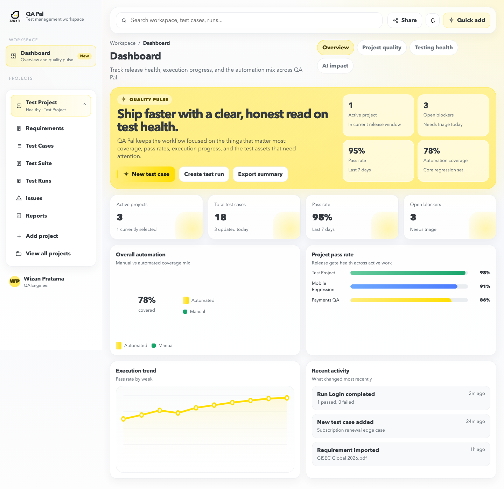
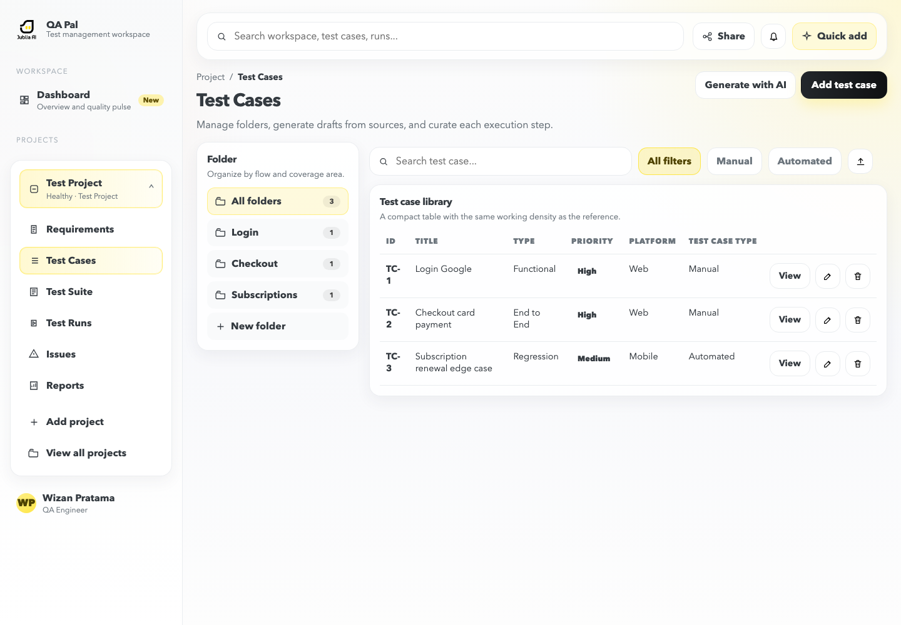

# QA Pal

QA Pal is a lightweight test-management workspace for organizing requirements, test cases, test suites, test runs, issues, and release-quality reporting in one focused interface.



## What’s included

- Dashboard with quality pulse, pass-rate metrics, automation coverage, execution trends, and recent activity.
- Project workspace navigation with multiple sample projects.
- Requirement records with attachment metadata and import flow.
- Test-case library with folders, search, filters, priorities, platforms, and manual/automated coverage.
- Test suites and test runs with execution status, progress, and run details.
- Issue tracking with priority, status, assignee, and update information.
- Reports and workspace settings.
- Quick-add actions, toast feedback, drawers, modals, and responsive sidebar behavior.
- Local persistence through `localStorage`, so edits remain available in the same browser.

## Test-case library



## Run locally

QA Pal is a dependency-free browser app. No build step is required.

```bash
python3 -m http.server 4173
```

Open [http://127.0.0.1:4173](http://127.0.0.1:4173) in a browser.

You can also use any static web server that serves the project directory. Opening `index.html` directly may work for basic browsing, but a local server is recommended because the app uses ES modules.

## Available views

The app uses hash-based navigation:

| View | URL |
| --- | --- |
| Dashboard | `/#dashboard` |
| Projects | `/#projects` |
| Requirements | `/#requirements` |
| Test cases | `/#test-cases` |
| Test suite | `/#test-plans` |
| Test runs | `/#test-runs` |
| Issues | `/#issues` |
| Reports | `/#reports` |
| Settings | `/#settings` |

## Project structure

```text
.
├── app.js                 # Application state, routing, rendering, and interactions
├── index.html             # App shell and entry point
├── styles.css             # Layout, components, themes, and responsive styles
├── assets/                # Brand assets
├── public/                # Public assets such as the favicon
└── screenshots/           # README product screenshots
```

## Tech notes

- Vanilla JavaScript with ES modules.
- No framework or package installation required.
- Client-side state is initialized from sample QA data and saved to `localStorage` under the app’s storage key.
- Navigation is handled with `location.hash`, so views can be bookmarked directly.

## License

This project is currently an internal prototype. Add the project’s preferred license here before publishing it publicly.
